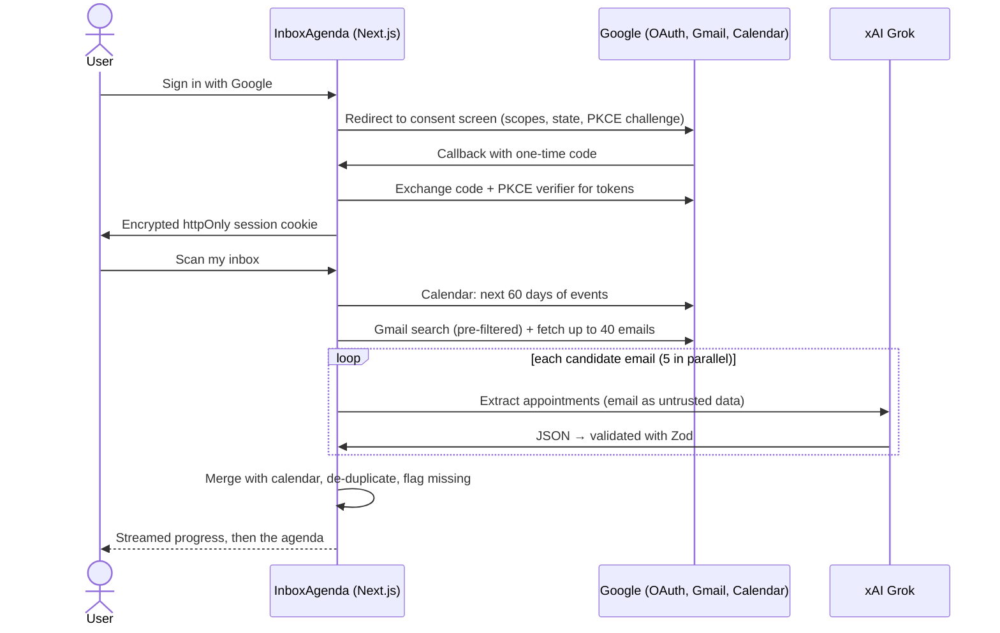

# InboxAgenda

> Sign in with Google to browse your important email, and let AI find the meetings, interviews, bookings and appointments hiding in your Gmail, merged with your Google Calendar, with the ones **missing from your calendar** highlighted.

<!-- Add a screenshot or GIF here:  -->

## The problem

Plenty of appointments only ever exist as an email: the clinic's "your appointment is confirmed for Friday 4pm", a recruiter's "let's talk Thursday", a hotel booking, a train ticket. They never reach your calendar, so they're easy to miss. InboxAgenda reads both and shows **one agenda**, flagging what your calendar doesn't know about.

## Features

- 🔐 **Sign in with Google**: OAuth 2.0 authorization code flow with **PKCE** and **state** (CSRF protection), implemented by hand
- 👀 **Read-only** access to Gmail and Calendar: the app can't send, delete or change anything
- 🤖 **AI extraction** with xAI Grok: title, time (relative dates resolved), location, meeting link, organizer, status (scheduled / rescheduled / cancelled), confidence
- 🧩 **Smart merge**: matches email appointments against calendar events, collapses duplicate emails (confirmation + reminder), and flags **"Not in your calendar"**
- 📥 **Gmail-style mail client (read-only):** Inbox with Primary / Promotions / Social / Updates tabs, Starred, Important (Gmail's own ML-ranked importance), Sent, Drafts, All Mail, Spam and Trash, with unread counts, a collapsible sidebar, pill search with Gmail syntax (`from:amazon`, `has:attachment`…), "1–50 of N" paging, and a full message view with "3 of 50" navigation; the browser back button works through `?id=` / `?q=` / `?tab=` URLs
- ✨ **"Find appointments"** on any open email: runs the AI on just that message
- 💼 **Job application assistant:** on a recruiter email or job post, **"Draft application"**:
  1. AI extracts the role, company, skills, deadline, how to apply and what they asked for.
  2. It picks the best of your resumes, with a reason.
  3. It writes a tailored reply using **only facts from your profile** (no invented experience), with your portfolio, GitHub and LinkedIn links and signature.
  4. You edit it, then **Create Gmail draft** saves it as a threaded reply with the resume PDF attached. It never sends; you review and press Send in Gmail.
- 👤 **Job profile:** details, links, a summary, a signature and up to 5 labelled resume PDFs, stored **only in your browser** (IndexedDB); plus a **Job emails** view (a preset Gmail search for recruiter and hiring mail)
- ⚡ **Live scan progress** streamed from the server
- 🗓️ Agenda grouped **Today / Tomorrow / This week / Later**, with links to join the meeting, open the email, or open the calendar event
- 🔒 **Nothing stored**: no database; emails are fetched from Gmail on demand and never saved

## How it works



### Design decisions

- **OAuth by hand instead of an auth library.** It keeps the flow visible: `state` stops forged callbacks, PKCE makes an intercepted code useless, `access_type=offline` returns a refresh token, and the ID token is verified to identify the user. Users can untick permissions on Google's consent screen, so granted scopes are checked.
- **Tokens in an encrypted cookie, no database.** The session (tokens + profile) is AES-256-GCM encrypted (JWE) into an `httpOnly`, `SameSite=Lax` cookie. The browser can't read or alter it, and v0.1 needs no database. The access token is refreshed automatically when it's about to expire.
- **Minimal scopes.** `gmail.readonly` and `calendar.events.readonly`, plus `gmail.compose` for job-application drafts. Compose is optional: the app works without it and asks for it only when you create a draft. Google's compose scope would also allow sending, but the app only ever calls `drafts.create`.
- **Drafts are built by hand as MIME.** A `multipart/mixed` message with a base64 text part and the PDF attachment, plus `In-Reply-To`/`References` headers and the `threadId`, so the draft lands in the same Gmail thread. Header values come partly from the browser, so CR/LF are stripped (no header injection), non-ASCII subjects are RFC 2047-encoded, and filenames are sanitised.
- **Resumes stay in the browser.** PDFs live in IndexedDB. The server reads a PDF's text once (to let the AI compare resumes) and stores nothing. The chosen PDF is sent only when creating the draft.
- **Pre-filter before AI.** A Gmail search (`newer_than:30d -category:promotions …` plus keywords like *appointment*, *interview*, *booking*, `filename:ics`) keeps cost and latency down. Only those candidates go to Grok.
- **Treat email as untrusted input.** An email could contain "ignore previous instructions…". The model is told the email is data, it can only *return JSON* (it has no tools or actions), every item is validated with Zod, invalid items are dropped individually, and only `https://` meeting links become clickable.
- **Conservative matching.** An email appointment matches a calendar event only if it starts within 2 hours **and** shares a meaningful title word or the same meeting link. Time alone isn't enough: a 3pm dentist appointment must not be hidden by an unrelated 3pm standup.
- **Emails rendered as text, not HTML.** The reader shows the plain-text version (or HTML converted to text) and turns `http(s)` URLs into links. Rendering raw email HTML would need sandboxing, and would load tracking pixels and remote content.
- **"Important" comes from Gmail.** Gmail already ranks importance with its own models (the `IMPORTANT` label), so the app uses that instead of spending AI calls on every email. Opening an email doesn't mark it as read, because the app only has read-only access.
- **Streaming progress.** `/api/scan` streams newline-delimited JSON events, so the UI shows "Reading your calendar… Searching email… Analysing 12/31…".

## Getting started

### 1. Google Cloud setup (one time, ~15 minutes)

1. Open [Google Cloud Console](https://console.cloud.google.com/) and **create a project**.
2. **APIs & Services → Library**: enable the **Gmail API** and the **Google Calendar API**.
3. **OAuth consent screen**: choose *External*, fill in the app name and your email, leave **Publishing status: Testing**, and under **Test users** add the Google accounts that will use the app.
4. Under **Data access / Scopes**, add `.../auth/gmail.readonly`, `.../auth/calendar.events.readonly` and `.../auth/gmail.compose` (for application drafts).
5. **Credentials → Create credentials → OAuth client ID → Web application**, with authorized redirect URI `http://localhost:3000/api/auth/callback/google`.
6. Copy the client ID and client secret.

### 2. Run locally

```bash
git clone https://github.com/alokera/inbox-agenda.git
cd inbox-agenda
npm install
cp .env.example .env.local
# fill in GOOGLE_CLIENT_ID, GOOGLE_CLIENT_SECRET, XAI_API_KEY
# and SESSION_SECRET: openssl rand -base64 32
npm run dev
```

Open http://localhost:3000 and sign in. You land on your **Inbox**; open **Agenda** and click **Scan my inbox** to build your agenda.

> Google shows a **"Google hasn't verified this app"** warning for apps in Testing mode. Click *Continue*. That's expected for a personal project.

### Tests

```bash
npm test
```

Unit tests cover MIME building (header injection, RFC 2047, attachments, threading), parsing the AI's application output (including resume ids it made up), safe post-login redirects, email parsing (nested multipart, HTML-to-text, entities, sender addresses, attachments), safe link detection, date and avatar formatting, validation of AI output (bad JSON, invalid items, unsafe links), the merge rules (matching, de-duplication, cancellations, past events), session encryption (tampering, wrong key, expiry) and agenda grouping.

## Limitations & production notes

- **Google verification:** `gmail.readonly` is a *restricted* scope. While the app is in **Testing** mode, only listed test users (up to 100) can sign in, and Google expires their refresh tokens after about 7 days, so they sign in again weekly. A public launch would require Google's app verification and a third-party security assessment.
- **AI provider:** the text of candidate emails is sent to xAI for extraction, and the landing page says so.
- **Scale:** each scan reads up to 40 emails synchronously. v0.2 moves this into background jobs.

## Roadmap

- [x] **v0.1:** Google sign-in, Gmail + Calendar read-only, mail views (Important / Inbox / Unread / Starred) with search and reader, AI extraction, merge + "missing from calendar", streamed progress
- [ ] **v0.2:** Postgres (encrypted refresh tokens, extracted appointments), incremental sync via Gmail `historyId`, background scans with [TaskForge](https://github.com/alokera/taskforge), `.ics` attachment parsing
- [ ] **v0.3:** One-click "Add to Google Calendar", daily digest email, "Am I free Friday afternoon?" chat, real-time updates via Gmail push notifications

## License

MIT
